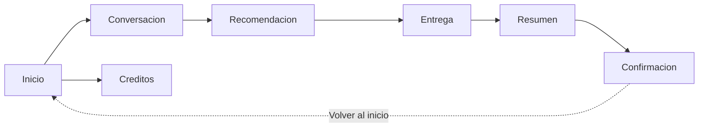
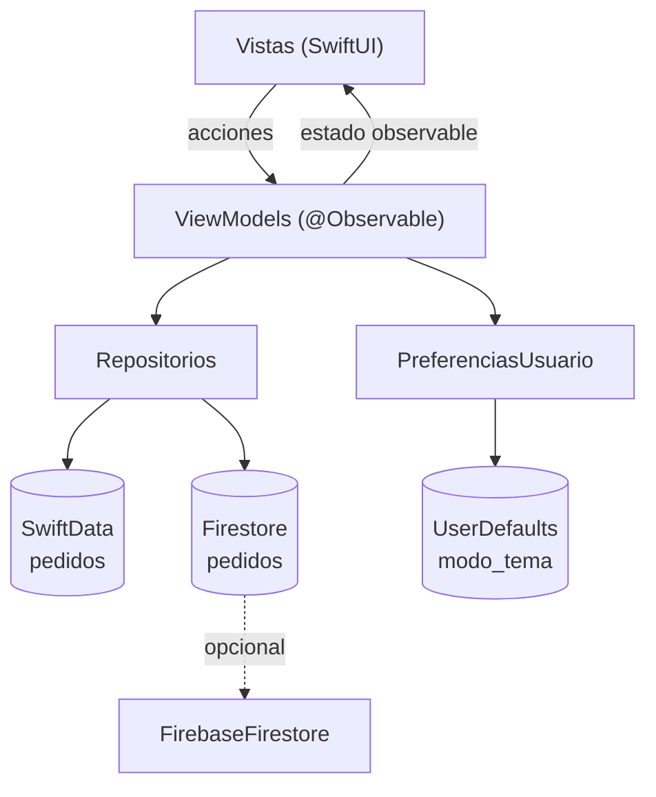

# OrderBot 🍔

App de pedidos de comida para iOS, escrita en **SwiftUI**. El usuario conversa con un bot, arma su carrito desde el catálogo, recibe una recomendación de complementos, elige dirección y método de pago, y confirma el pedido. El pedido se guarda localmente con **SwiftData** y, opcionalmente, se replica en **Cloud Firestore**.

> Port a iOS de la app Android original (Jetpack Compose + Room + DataStore). El código conserva las mismas claves de localización, el mismo formato de datos y los mismos flujos de navegación para facilitar la comparación entre ambas versiones.

---

## Contenido

- [Características](#características)
- [Flujo de la app](#flujo-de-la-app)
- [Arquitectura](#arquitectura)
- [Estructura del proyecto](#estructura-del-proyecto)
- [Requisitos](#requisitos)
- [Cómo compilar y ejecutar](#cómo-compilar-y-ejecutar)
- [Pruebas](#pruebas)
- [Catálogo y precios](#catálogo-y-precios)
- [Tema y localización](#tema-y-localización)
- [Firestore (opcional)](#firestore-opcional)
- [Estado del proyecto y limitaciones](#estado-del-proyecto-y-limitaciones)
- [Autores](#autores)

---

## Características

- 🛒 **Catálogo interactivo** con selector de cantidad por producto.
- 🤖 **Recomendación de complementos** (papas y bebida) antes de pagar.
- 🚚 **Datos de entrega**: dirección validada y tres métodos de pago.
- 🧾 **Resumen del pedido** con subtotal, envío y total en pesos colombianos (`$29.000`).
- 💾 **Persistencia local** con SwiftData: pedido e ítems se guardan en una sola transacción y reciben un número consecutivo.
- ☁️ **Sincronización opcional** con Cloud Firestore (la app funciona sin Firebase).
- 🌗 **Tema claro / oscuro / automático**, persistido entre ejecuciones con `UserDefaults`.
- 🌐 **Localización** centralizada en un `String Catalog` (`Localizable.xcstrings`).
- ♿️ **Accesibilidad**: etiquetas para VoiceOver y áreas de toque mínimas de 44 pt.
- ✅ **Pruebas unitarias** de la lógica de negocio y del formato de precios.

---

## Flujo de la app



| Pantalla | Descripción |
| --- | --- |
| `PantallaInicio` | Bienvenida, beneficios, acceso a créditos y cambio de tema. |
| `PantallaConversacion` | Saludo del bot + catálogo con controles de cantidad. |
| `PantallaRecomendacion` | Ofrece agregar papas y bebida al pedido. |
| `PantallaEntrega` | Dirección de entrega y método de pago. |
| `PantallaResumen` | Detalle de productos, envío y total antes de confirmar. |
| `PantallaConfirmacion` | Número de pedido generado y estado inicial. |
| `PantallaCreditos` | Logo, versión, autores y equipo de desarrollo. |

La navegación se modela con un `enum Ruta: Hashable` y un `NavigationStack` cuyo `path` vive en `AppRouter`, en lugar del `NavHostController` de Compose.

---

## Arquitectura

El proyecto sigue **MVVM** con estado unidireccional:



- **Vistas "tontas"**: reciben datos y notifican acciones mediante closures; no contienen lógica de negocio.
- **ViewModels** (`@MainActor @Observable`): `PedidoViewModel` (carrito y confirmación), `TemaViewModel` (tema) y `FirestoreViewModel` (estado remoto).
- **Repositorios**: `PedidoRepository` encapsula SwiftData; `FirestoreRepository` encapsula Firestore.
- **Modelos puros**: `Producto`, `ItemPedido`, `ResumenPedido`, `MetodoPago` y `ModoTema`, testeables sin UI ni base de datos.

### Decisiones de diseño

| Android (original) | iOS (este proyecto) |
| --- | --- |
| Jetpack Compose | SwiftUI |
| `NavHostController` | `NavigationStack` + `AppRouter` |
| Room (`@Transaction`) | SwiftData (`ModelContext.save()` + `rollback()`) |
| DataStore Preferences | `UserDefaults` |
| `StateFlow` + `collectAsState` | `@Observable` + observación directa |
| `stringResource(R.string...)` | `L.t("clave")` sobre `Localizable.xcstrings` |
| Material 3 `ColorScheme` | `PaletaOrderBot` inyectada por `Environment` |
| Firebase Tasks (`await()`) | `async/await` nativo |

---

## Estructura del proyecto

```
OrderBot/
├── App/
│   ├── OrderBotApp.swift          # Punto de entrada; crea contenedor y ViewModels
│   ├── RootView.swift             # NavigationStack y tema global
│   ├── AppRouter.swift            # Rutas type-safe y pila de navegación
│   └── ContenedorPreview.swift    # ModelContainer en memoria para previews
├── Modelos/
│   ├── Producto.swift             # Producto + Catalogo (precios)
│   ├── ResumenPedido.swift        # ItemPedido y cálculo de totales
│   ├── MetodoPago.swift
│   └── ModoTema.swift
├── Datos/
│   ├── PedidoRepository.swift     # Guardado transaccional
│   ├── PedidoEntity.swift         # @Model de SwiftData
│   ├── FirestoreRepository.swift  # Firestore (condicional)
│   ├── PedidoRemoto.swift         # DTO Codable
│   └── PreferenciasUsuario.swift  # UserDefaults
├── VistasModelo/
│   ├── PedidoViewModel.swift
│   ├── TemaViewModel.swift
│   └── FirestoreViewModel.swift
├── UI/
│   ├── Pantallas/                 # Una vista por pantalla
│   ├── Componentes/               # Botones, tarjetas, selector de cantidad…
│   └── Tema/                      # Colores, tipografía y paleta
├── Util/
│   ├── FormatoPrecio.swift        # "$29.000" (es-CO)
│   └── Localizacion.swift         # L.t(clave, argumentos...)
├── Assets.xcassets/
└── Localizable.xcstrings

OrderBotTests/
├── FormatoPrecioTests.swift
└── ResumenPedidoTests.swift
```

---

## Requisitos

| Herramienta | Versión |
| --- | --- |
| Xcode | 26.0 o superior |
| Swift | 5.0 (modo de lenguaje) |
| iOS | 26.0 o superior |
| SwiftUI / SwiftData / Observation | Frameworks del sistema |

No se requieren dependencias externas para compilar. Firebase es opcional.

---

## Cómo compilar y ejecutar

1. Clona el repositorio:

   ```bash
   git clone https://github.com/jj-jpg-117/OrderSwift.git
   cd OrderSwift
   ```

2. Abre el proyecto:

   ```bash
   open OrderBot.xcodeproj
   ```

3. Selecciona el esquema **OrderBot**, elige un simulador y pulsa **Run** (`⌘R`).

También puedes compilar desde la terminal:

```bash
# Debug para simulador
xcodebuild -project OrderBot.xcodeproj -scheme OrderBot \
  -destination 'platform=iOS Simulator,name=iPhone 17' \
  -configuration Debug build

# Release
xcodebuild -project OrderBot.xcodeproj -scheme OrderBot \
  -destination 'platform=iOS Simulator,name=iPhone 17' \
  -configuration Release build
```

---

## Pruebas

El target **OrderBotTests** contiene 9 pruebas unitarias que no necesitan red ni servicios externos:

```bash
xcodebuild -project OrderBot.xcodeproj -scheme OrderBot \
  -destination 'platform=iOS Simulator,name=iPhone 17' test
```

O desde Xcode con `⌘U`.

| Suite | Qué cubre |
| --- | --- |
| `ResumenPedidoTests` | Total por ítem, subtotal, envío por defecto/personalizado y pedido vacío. |
| `FormatoPrecioTests` | Formato de pesos colombianos: miles, millones, cero y sin separador. |

---

## Catálogo y precios

Todos los valores están en pesos colombianos (COP) y viven en `Catalogo` (`Modelos/Producto.swift`), la única fuente de verdad:

| Producto | Precio |
| --- | ---: |
| 🍔 Hamburguesa | $20.000 |
| 🍕 Pizza | $12.000 |
| 🌮 Tacos | $15.000 |
| 🌯 Burrito | $14.000 |
| 🍗 Pollo broaster | $18.000 |
| 🌭 Hot dog | $8.000 |
| 🥗 Ensalada | $10.000 |
| 🍟 Papas | $5.000 |
| 🥤 Bebida | $4.000 |
| 🍦 Helado | $6.000 |

**Costo de envío:** $5.000.

Para agregar un producto basta con añadirlo al `Catalogo` y registrar sus textos en `Localizable.xcstrings`.

---

## Tema y localización

### Tema

`ModoTema` cicla `SISTEMA → CLARO → OSCURO → SISTEMA` y se guarda en `UserDefaults` bajo la clave `modo_tema` (mismos valores que la app Android: `SISTEMA`, `CLARO`, `OSCURO`). La paleta (`PaletaOrderBot`) se inyecta en el entorno, de modo que ninguna vista usa colores fijos.

### Localización

Todos los textos visibles pasan por `L.t(...)` y se resuelven contra `Localizable.xcstrings`. Las claves son las mismas de `strings.xml` en Android, lo que permite comparar ambas versiones sin cambiar código.

> Los marcadores usan formato de Apple: `%1$@` para texto y `%1$d` para enteros.

El catálogo está en español (`sourceLanguage: "es"`) y queda listo para añadir más idiomas desde Xcode.

---

## Firestore (opcional)

`FirestoreRepository` está envuelto en `#if canImport(FirebaseFirestore)`. Sin Firebase, la app compila, funciona y el módulo remoto queda inactivo (`ErrorFirestore.noDisponible`).

Para habilitarlo:

1. En Xcode: **File → Add Package Dependencies…** y añade `https://github.com/firebase/firebase-ios-sdk`.
2. Selecciona al menos el producto **FirebaseFirestore**.
3. Agrega tu `GoogleService-Info.plist` al target **OrderBot**.
4. Inicializa Firebase en `OrderBotApp.init()`:

   ```swift
   import FirebaseCore
   // ...
   FirebaseApp.configure()
   ```

La colección usada es `pedidos`; el `id` del documento se mapea al campo `PedidoRemoto.id`.

> `PantallaDatosRemota` es una pantalla de comprobación que no está conectada al flujo principal.

---

## Estado del proyecto y limitaciones

- ☁️ **Firebase no está incluido** en el proyecto; la sincronización remota es opcional y está desactivada por defecto.
- 🖼️ **AppIcon** generado a partir de `logo_bot1.png` (`AppIcon-1024.png`, 1024×1024, opaco), por lo que ya no se muestra el icono genérico.
- 🚧 El botón **"Seguir pedido en vivo"** de la confirmación es un placeholder.
- 📱 El deployment target es **iOS 26.0**; para dar soporte a versiones anteriores hay que bajarlo en *Build Settings* y revisar las APIs usadas.
- 🔒 El proyecto no incluye reglas de seguridad de Firestore; deben configurarse en la consola antes de usarlo en producción.

---
